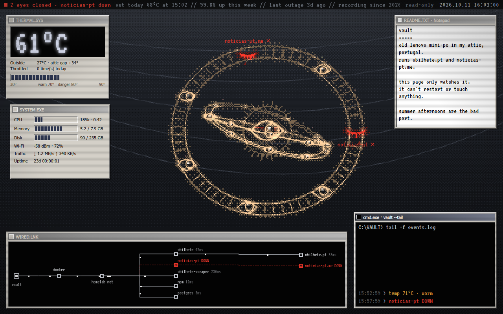

# vault-dashboard



A read-only dashboard for a small home server, styled as a Windows 2000 / *Serial
Experiments Lain* desktop. The wallpaper is a pixel-art ophanim with one eye per service
you watch. Healthy services keep their eyes open. A service that goes down closes its eye
and weeps. The wheels spin faster with CPU load and glow from cold white through amber
to red as the machine heats up.

Built for **vault**, an old mini-PC in a hot attic, but nothing in it is specific to vault.

- **Watches, never touches:** GET-only API, read-only mounts, no Docker socket.
- **Tiny:** Python standard library only, no runtime dependencies. Plain JS frontend, no build step.
- **Remembers:** samples every 5 minutes into SQLite and keeps 6 months.

## Run

```bash
cp .env.example .env              # set WIFI_IFACE, optionally LATITUDE/LONGITUDE
cp vault.example.json vault.json  # list your services
docker build -t vault-dashboard .
docker run -d --name vault-dashboard --env-file .env \
  -v /proc:/host/proc:ro -v "$PWD/data:/data" -v "$PWD/vault.json:/config/vault.json:ro" \
  --network <your-docker-network> -p 8080:8080 vault-dashboard
```

The container has to share a Docker network with the services it checks by name.
Create `data/` yourself first, owned by UID 1000.

## Configure

`vault.json` lists the services. Each one has an `id` and a `check`, which is one of
`http://…`, `https://…` or `tcp://host:port`. Add `parent` to mark a public site that is
served by one of the containers. Everything else comes from environment variables; see
`.env.example`.

An HTTP service counts as up while it answers with any status below 500. A service is
marked down after 2 failed checks in a row.

## Develop

```bash
python3 -m unittest discover -s tests -t .   # backend
npm install && npx playwright test           # frontend (dev only)
```

`design/` holds the original Claude Design handoff.

MIT licensed.
